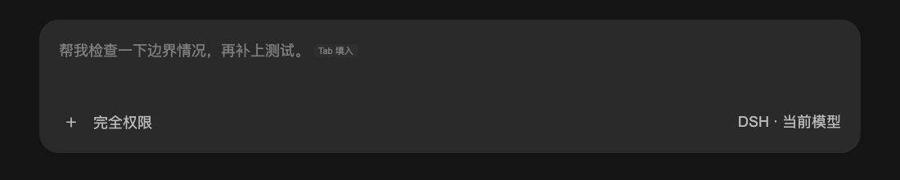

# DSH Prompt Prediction

**See a possible next prompt before you type it. You decide whether to use it.**

An unofficial DeepSeek Harness (DSH) plugin inspired by Codex's next-prompt interaction. After a normally completed agent turn, it displays a prediction as ghost text in the empty composer. **Tab / →** fills an editable draft; **nothing is sent automatically**.

[中文](README.md) · English · [Install](#install) · [Configuration](#configuration) · [Troubleshooting](#troubleshooting) · [Tests](#tests)



*Rendered with the plugin frontend and an example suggestion, not a model-accuracy benchmark or proof of full DSH end-to-end validation.*

This is a DSH plugin, not a standalone chat app or browser extension. No build step or standalone production dependencies are needed; DSH supplies the host services, Cordis and React.

## Requirements

- Declared DSH range: `>=0.2.1-rc.5 <0.3.0`. The integration targets `0.2.1-rc.5`; this range does not mean every release has been tested.
- Node.js 24 or newer for development and tests.
- DSH installed with its `dsh` CLI available, and a working model route in the target profile's session.

## Install

Clone this repository and link it into your DSH profile:

```sh
git clone https://github.com/QingJ01/dsh-prompt-prediction.git
cd dsh-prompt-prediction
dsh plugin --profile desktop add "link:$(pwd)"
```

Replace `desktop` with your profile name if needed. Keep the checkout at the same location while using a linked installation. Refresh existing GUI windows to load the client plugin; restart DSH if the host plugin does not load automatically.

### Update and remove

From the linked checkout, after saving any local changes:

```sh
git pull --ff-only
```

Restart DSH and refresh its windows so the host and frontend use the same version. If a fast-forward fails, resolve local branch differences rather than discarding your changes. Installation needs no `npm install` or build step.

To remove:

```sh
dsh plugin --profile desktop remove dsh-prompt-prediction
```

Removing the plugin does not itself delete existing audit logs. See [Model use and local data](#model-use-and-local-data) for their location.

## Interaction

- A normally completed agent turn triggers one prediction. Failed, interrupted and aborted turns do not.
- Suggestions appear only in a completely empty composer, without attachments, reference chips or queued messages.
- **Tab / →** fills the focused composer as an undoable draft edit. Review or edit it before sending.
- **Enter** remains owned by DSH's normal submission, queue and command handling. It does not accept a prediction.
- A polite accessible status describes the suggestion and acceptance keys. **Escape** dismisses the current suggestion so **Tab** can navigate normally; polling does not revive the dismissed suggestion for the same turn and text.
- State requests have a five-second deadline; failures clear stale suggestions and retry with bounded backoff.
- Typing, IME composition, menus, disabled input, running sessions and Plan mode hide the suggestion.
- A long suggestion uses a single-line preview with an ellipsis; acceptance inserts the full suggestion.
- Deleting back to an empty draft can show the same prediction again if it has not been dismissed and is still valid. A new user message or turn invalidates the old prediction.

The accessible description is an implementation feature, not a claim of screen-reader validation. The five-second state-request deadline is separate from the model request's configurable `timeoutMs`.

This follows the core Codex interaction, with deliberate DSH adaptations: Enter behavior is preserved, and the preview is a DOM overlay rather than an editor decoration.

## Configuration

The bundle adds a `prompt-prediction` row with working defaults. Override it in your profile's `cordis.patch.yml`:

```yaml
- id: prompt-prediction
  config:
    enabled: true
    maxSuggestionChars: 160
    timeoutMs: 15000
    auditLog: false
```

The example overrides defaults; the complete defaults are below. Reload the profile or restart DSH after changing configuration.

| Key | Default | Purpose |
| --- | --- | --- |
| `enabled` | `true` | Enable or disable the plugin. |
| `provider`, `model` | unset | Leave both unset to reuse the session route. Set both to use a separate prediction route with compact history. |
| `maxOutputTokens` | `1024` | Prediction output budget, including reasoning where applicable. |
| `timeoutMs` | `20000` | Model-request deadline in milliseconds; late results are discarded. |
| `maxSuggestionChars` | `200` | Maximum UTF-16 code units; truncation preserves surrogate pairs. Not a count of displayed characters. |
| `compactTurns` | `8` | User turns retained when using a separate route. |
| `maxHistoryChars` | `0` | Ordinary-text history guard; `0` disables it. This does not measure the full serialized request size. |
| `eagerWindowMs` | `1800000` | Milliseconds after the last browser interaction during which a session may generate background predictions (30 minutes). |
| `auditLog` | `true` | Write prediction and interaction records to the local audit log. |

A separate route can be configured with your own provider and model identifiers:

```yaml
- id: prompt-prediction
  config:
    provider: your-provider
    model: your-model
    compactTurns: 8
```

Set both route fields: supplying only one falls back to the session route. Positive numeric settings (`maxOutputTokens`, `timeoutMs`, `maxSuggestionChars`, `compactTurns`, `eagerWindowMs`) are rounded down; values below 1 or invalid values use defaults. Use `enabled: false`, not `timeoutMs: 0`, to disable prediction. Increasing `maxSuggestionChars` does not change the instruction's 200-character generation limit.

## Model use and local data

Each eligible turn makes an auxiliary model request. By default it uses the session's route, history and tool declarations so the provider may reuse its cached prefix; cache hits and free requests are not guaranteed. Cache behavior and cost depend on the provider; a cold, long conversation can be expensive. An alternate route uses a compact text history instead.

The request asks for `{"suggestion": "..."}` or `{"suggestion": null}`. Predictions are held in memory and are not appended to the agent's session history. Tool calls from a prediction are discarded rather than executed.

With `auditLog: true`, local records are written to `$DSH_HOME/prompt-prediction/events.jsonl` (or `~/.dsh/prompt-prediction/events.jsonl`). Records can include suggestion text, accepted/submitted text, timing, usage and interaction diagnostics. The log rotates at approximately 4 MiB, checked every 100 writes, keeping one previous file. Set `auditLog: false` to stop future writes; it does not delete existing files.

The browser bridge uses DSH's authenticated owner `connection.fetch` registry. Anonymous requests are rejected. No external analytics service is configured by this plugin; model requests still go to the configured model provider.

## Troubleshooting

| Symptom | What to check |
| --- | --- |
| `dsh: command not found` | Install DSH and make its CLI available in this terminal; this repository does not include DSH. |
| No ghost text after installation | Check the target profile, refresh the window and restart if needed; check `enabled` and the model route. |
| Suggestions appear only sometimes | A completed turn and empty composer are required; declines, invalid output or timeouts can yield no suggestion. |
| Tab does not fill the draft | Focus the editable composer, close menus, finish IME composition, and remove drafts, attachments, references and queued messages. |
| Tab should move focus instead | Press Escape first, or use Shift+Tab to move backward. |
| Suggestions disappear and later return | State-request failures clear stale text and retry; check the DSH connection. |
| Tests are skipped | Transport integration tests need an extracted DSH runtime; skipped does not mean passed. |

Report problems through [Issues](https://github.com/QingJ01/dsh-prompt-prediction/issues). Include DSH, Node and OS versions, the installation profile, reproduction steps, expected/actual behavior and redacted configuration. Do not upload full conversations or audit logs; remove prompts, paths, credentials and other sensitive details first.

## Architecture

- `lib/index.js`: host lifecycle, auxiliary model calls, authenticated Fetch routes and local feedback.
- `lib/client.js`: composer overlay, measurement, placeholder ownership and keyboard acceptance. It loads React from DSH's module table.
- `lib/prediction.js`: configuration, history handling, prediction instruction and response parsing.
- `cordis.patch.yml`: bundle configuration.

The plugin observes session events and invalidates stale results on new messages or turns. Cancellation, deadlines, revision guards and response budgets prevent stale results from overwriting a draft or accumulating without bounds inside the plugin. A provider that ignores cancellation may still retain its own underlying request.

## Tests

The standard suite runs without installing dependencies:

```sh
npm test
```

Four transport integration tests load functions from an extracted, locally installed DSH runtime. Without that runtime, those four tests explicitly skip. Set `DSH_EXTRACTED_ROOT` to a directory containing package folders such as `dsh-client-connection` and `dsh-llm`:

```sh
DSH_EXTRACTED_ROOT=/path/to/extracted-dsh npm test
```

The integration tests exercise the actual HTTP bridge, owner Fetch registry and assistant-message provenance boundary. Test auditing is disabled, so the tests do not append fabricated interactions to your DSH audit log.

### Browser regression checks

Requires Node.js 24 and Google Chrome at its standard macOS application path. Download React's test runtimes first:

```sh
mkdir -p /tmp/pp-review-browser
curl -fLsS https://unpkg.com/react@18.3.1/umd/react.development.js -o /tmp/pp-review-browser/react.js
curl -fLsS https://unpkg.com/react-dom@18.3.1/umd/react-dom.development.js -o /tmp/pp-review-browser/react-dom.js
node test/browser-review.mjs
```

This starts an isolated headless browser and a temporary fixture server. It checks actual rendering, placeholder restoration, hint alignment, narrow layouts, menus, composition, busy/Plan states and session switching. Screenshots are written under `artifacts/review/`.

For the stronger HTTP-to-Lexical check:

```sh
DSH_EXTRACTED_ROOT=/path/to/extracted-dsh node test/browser-review.mjs --integrated
```

This loads the installed DSH's real HTTP bridge, model provenance boundary, Lexical editor, input shell and keymap. It checks Tab/ArrowRight insertion, no automatic send, undo/redo, stale-revision refusal and preserving Enter behavior. Model output and owner identity are deterministic fixtures; unrelated business services use test substitutes. It does not send messages from an existing DSH conversation. DSH source code and extracted application assets are not distributed in this repository.

## Compatibility limits

- Some integration points are specific to DSH `0.2.1-rc.5`; later releases can change them.
- Plan and queue suppression are client-side. Recently watched sessions can still incur background prediction cost within `eagerWindowMs`.
- The overlay cannot render file-reference chips inside suggestions.
- Catch-up uses the session event snapshot; negative results are cached to avoid scanning on every poll.
- Full Desktop IPC, every external model provider and screen readers have not been validated end to end.
- Suggestions are guesses: neither availability after every turn nor correctness is guaranteed.
- Browser fixtures and integration tests do not replace checking the result in your own DSH window.

## License

[MIT](LICENSE). Unofficial project, not affiliated with DeepSeek or OpenAI.
