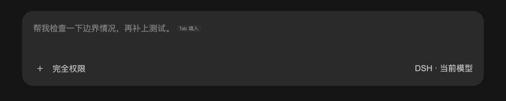

# DSH Prompt Prediction

**让下一句提示词先出现在输入框里，由你决定是否采用。**

DeepSeek Harness（DSH）的非官方插件：Agent 正常完成一轮回复后，预测你可能输入的下一句话，以灰字显示在空输入框中。按 **Tab / →** 填入可编辑草稿，**不会自动发送**。

中文 · [English](README.en.md) · [安装](#安装) · [配置](#配置) · [排障](#常见问题) · [开发与测试](#开发与测试)

| 项目 | 说明 |
| --- | --- |
| 运行环境 | DSH 插件，不是独立聊天应用或浏览器扩展 |
| 声明兼容范围 | DSH `>=0.2.1-rc.5 <0.3.0`；适配基于 `0.2.1-rc.5`，不表示范围内每个版本都已实测 |
| Node.js | `>=24.0.0`；本地开发和测试需要 |
| 构建与依赖 | 无构建步骤；DSH 提供 Cordis、Schemastery、React 等宿主能力 |
| 模型费用 | 预测会额外请求模型，可能计费 |
| 本地日志 | 默认开启，可能记录预测及交互文本；可用 `auditLog: false` 关闭 |
| 许可证 | [MIT](LICENSE) |

## 效果预览



*由插件前端渲染，建议内容为示例文本；这不是模型准确率或完整 DSH 端到端验收证明。*

## 中文说明

交互参考 Codex 的下一句预测，但不是 Codex 或 DeepSeek 的官方插件。建议只是模型推测，采纳后仍应检查；插件不会替你发送消息或执行预测中的工具调用。

<a id="install"></a>

## 安装

前提：已安装兼容的 DSH，终端可运行 `dsh`，目标 profile 中的会话已有可用模型路由。

```sh
git clone https://github.com/QingJ01/dsh-prompt-prediction.git
cd dsh-prompt-prediction
dsh plugin --profile desktop add "link:$(pwd)"
```

- 使用其他 profile 时，将 `desktop` 替换为对应名称。
- 刷新已有 DSH 窗口以加载前端；Host 插件未自动加载时重启 DSH。
- link 安装依赖此目录，请勿移动或删除；无需先运行 `npm install` 或构建。

### 更新与移除

在插件目录中、确认本地修改已保存后更新：

```sh
git pull --ff-only
```

随后重启 DSH 并刷新窗口，使 Host 与前端使用同一版本。若快进更新失败，先处理本地分支差异，不要用强制重置覆盖自己的修改。

```sh
dsh plugin --profile desktop remove dsh-prompt-prediction
```

移除插件不会由本插件清理已有审计日志；如需删除记录，请自行处理下方说明的日志目录。

<a id="interaction"></a>

## 使用方式

1. 正常提问，等待 Agent **正常完成**一轮回复；失败、中断、取消等状态不触发预测。
2. 输入框完全为空且没有附件、引用或排队消息时，才可能显示灰字建议。
3. 聚焦输入框，采纳或忽略建议；采纳后可修改，再自行发送。

| 操作或状态 | 行为 |
| --- | --- |
| **Tab / →** | 填入可编辑草稿，支持撤销、重做，不发送 |
| **Esc** | 忽略当前建议，随后 Tab 可移动焦点；轮询不恢复同一轮的同一条建议 |
| **Enter** | 保留 DSH 原有发送、排队、命令处理逻辑，不用于采纳 |
| 输入文字、IME 组字、打开菜单 | 隐藏建议，不干扰当前输入 |
| 会话运行中、Plan 模式或输入框禁用 | 隐藏建议 |
| 长建议 | 单行省略预览，采纳时填入完整建议 |
| 删除草稿至空白 | 当前建议未被忽略且仍有效时，可以再次显示 |

插件提供供辅助技术读取的建议全文与按键说明；这不等于已经完成各类屏幕阅读器实测。状态读取请求超过 **5 秒**会隐藏旧建议并退避重试；这与模型请求的 `timeoutMs` 是两个不同限制。

<a id="configuration"></a>

## 配置

打开 **插件 → 提示词预测 → 预测设置**，可调整预测开关、建议长度、模型请求超时、输出 token 预算和本地审计日志。点击「保存」后立即生效；离开页面会放弃未保存的编辑。恢复默认会回到当前 profile 的继承值，不一定是下表中的内置默认值。

关闭预测会取消待处理请求并清除旧建议。重新开启或改变预测参数后，空输入框可能对最近完成的一轮重新生成建议，产生额外模型请求。关闭日志不会删除已有文件。只读部署不可保存。

插件包会插入 ID 为 `prompt-prediction` 的配置行。在目标 profile 的 `cordis.patch.yml` 中覆盖该行，例如：

```yaml
- id: prompt-prediction
  config:
    enabled: true
    maxSuggestionChars: 160
    timeoutMs: 15000
    auditLog: false
```

示例不是默认值；完整默认值如下。修改后重新加载对应 profile 或重启 DSH。

| 参数 | 默认值 | 含义 |
| --- | --- | --- |
| `enabled` | `true` | 是否启用预测；设为 `false` 关闭 |
| `provider`, `model` | 未设置 | 均不设置时沿用会话路由；必须同时设置才能使用独立预测路由 |
| `maxOutputTokens` | `1024` | 预测输出 token 预算，适用时包括推理 token |
| `timeoutMs` | `20000` | 模型请求超时，单位毫秒；超时后丢弃迟到结果 |
| `maxSuggestionChars` | `200` | 建议长度上限，以 UTF-16 单元计数，截断不拆开代理对；不是屏幕显示字数 |
| `compactTurns` | `8` | 独立路由保留的用户轮次数 |
| `maxHistoryChars` | `0` | 普通文本历史长度保护；`0` 关闭，不代表完整序列化请求大小 |
| `eagerWindowMs` | `1800000` | 最近被浏览器访问后允许后台预测的窗口，毫秒（30 分钟） |
| `auditLog` | `true` | 是否将预测与交互记录写入本地日志 |

输出预算、模型超时和建议长度由 DSH 配置 schema 校验，必须为正整数；超时不能超过 `2147483647` 毫秒。旧配置中的零、小数或字符串需先改为有效值。精简轮数和后台窗口仍向下取整，不足 `1` 或无效值回退默认值。关闭预测应使用 `enabled: false`，而不是 `timeoutMs: 0`。

独立模型配置（标识符需替换为 DSH 中实际可用的值）：

```yaml
- id: prompt-prediction
  config:
    provider: your-provider
    model: your-model
    compactTurns: 8
```

只设置 `provider` 或 `model` 之一会回退到会话路由。`maxSuggestionChars` 只限制接收长度；增大它不会改写模型指令中“最多 200 字符”的要求。

<a id="model-use-and-local-data"></a>

## 模型费用与隐私

默认沿用会话的模型路由、历史及工具声明，额外发起预测请求。提供商可能复用前缀缓存，但**不保证命中缓存或免费**；长会话和冷缓存尤其需要关注费用。独立路由只使用精简文本历史。

预测保存在插件内存中，不加入 Agent 会话历史。预测中的工具调用会被丢弃。Plan 模式及排队状态的隐藏逻辑在客户端；最近访问过的会话仍可能在 `eagerWindowMs` 内产生后台预测费用。

默认审计日志位置：

- 设置了 `DSH_HOME`：`$DSH_HOME/prompt-prediction/events.jsonl`。
- 未设置：`~/.dsh/prompt-prediction/events.jsonl`。

日志可能包含预测、采纳与提交文本、耗时、用量及交互诊断。每 100 次写入检查大小，超过约 4 MiB 时轮转，保留一个旧文件。`auditLog: false` 停止后续写入，**不会删除已有文件**。

插件未配置外部分析服务；模型请求仍会发送到所配置的提供商。浏览器桥接使用 DSH owner 身份认证，匿名请求会被拒绝。提交 issue 前请删去日志中的提示词、路径、密钥及其他敏感内容。

## 常见问题

| 现象 | 建议检查 |
| --- | --- |
| `dsh: command not found` | 先安装 DSH 并确保 CLI 可在终端运行；本仓库不包含 DSH |
| 安装后没有灰字 | 确认安装到当前 profile，刷新窗口，必要时重启；检查 `enabled` 与模型路由 |
| 只有部分回复后有建议 | 需正常结束且输入框为空；模型拒绝、输出无效或超时也可能没有建议 |
| 按 Tab 没有填入 | 聚焦可编辑输入框，关闭菜单，结束 IME 组字；检查附件、引用、队列及草稿 |
| 想用 Tab 切换焦点 | 先按 Esc 忽略当前建议，或使用 Shift+Tab 向前移动 |
| 建议消失后又恢复 | 状态请求失败或超时会清空旧建议并重试；检查 DSH 连接 |
| 测试显示跳过 | 部分集成测试需要提取的 DSH runtime；跳过不代表验证通过 |

仍有问题？请到 [Issues](https://github.com/QingJ01/dsh-prompt-prediction/issues) 提供 DSH/Node/操作系统版本、安装 profile、复现步骤、预期与实际结果，以及脱敏后的相关配置。不要直接上传完整会话或审计日志。

<a id="architecture"></a>
<a id="tests"></a>

## 开发与测试

| 文件 | 职责 |
| --- | --- |
| `lib/index.js` | Host 生命周期、辅助模型请求、认证桥接与审计日志 |
| `lib/client.js` | 输入框浮层、布局、占位文字与键盘采纳 |
| `lib/prediction.js` | 配置归一化、历史处理、预测指令与结果解析 |
| `cordis.patch.yml` | 插件默认配置行 |

安装开发依赖后运行（宿主依赖由 DSH 提供）：

```sh
npm install --ignore-scripts
npm test
```

四项传输集成测试需要提取的 DSH runtime；缺少时明确跳过。通过 `DSH_EXTRACTED_ROOT` 指定包含 `dsh-client-connection`、`dsh-llm` 等包目录的位置：

```sh
DSH_EXTRACTED_ROOT=/path/to/extracted-dsh npm test
```

<a id="browser-regression-checks"></a>

浏览器回归依赖与命令见 [Browser regression checks](README.en.md#browser-regression-checks)。该脚本使用 macOS 标准 Chrome 路径；浏览器夹具、真实 HTTP/Lexical 集成、Desktop IPC 和模型提供商实测是不同验证层级，不能相互替代。仓库不分发 DSH 源码或提取的资源。

<a id="compatibility-limits"></a>

## 兼容性边界

- 依赖 DSH `0.2.1-rc.5` 的部分内部接口，后续版本可能改变。
- 预测仅是普通文本，不渲染文件引用芯片。
- 超时阻止插件接收迟到结果；提供商若忽略取消，底层请求可能仍继续。
- 完整 Desktop IPC、所有外部模型提供商和各类屏幕阅读器尚未完成端到端验证。
- 不自动发送，不保证每轮都有建议，也不保证建议正确。

## English documentation

See the [English guide](README.en.md) for installation, configuration, privacy, troubleshooting and test commands.

## License

[MIT](LICENSE)。非官方项目，与 DeepSeek 或 OpenAI 无隶属关系。
